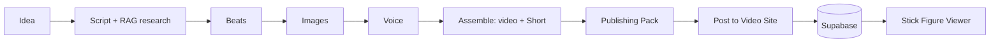

# Stick Figure Studio

Stick Figure Studio automates most of the work behind narrated stick-figure history videos. It takes a
story from idea to finished video: research, script writing, voice-over, image prompts, video assembly and
publishing, all in one app and far faster than doing each step by hand.

Every finished video can be posted to **Stick Figure Viewer**, a public site where anyone can watch the
videos, search them by meaning and ask a chatbot questions about each story:
**https://stick-figure-viewer.vercel.app**. See [The public site](#the-public-site) below, or the full
write-up in [docs/PUBLIC_SITE.md](docs/PUBLIC_SITE.md).

**Want to run it yourself?** See [Getting started](#getting-started).

## Contents

- [Getting started](#getting-started)
- [Why I built it](#why-i-built-it)
- [How it works](#how-it-works)
- [The studio (local app)](#the-studio-local-app)
  - [Starting a project](#starting-a-project)
  - [1. Script (with RAG research)](#1-script)
  - [2. Beats](#2-beats)
  - [3. Images](#3-images)
  - [4. Voice](#4-voice)
  - [5. Assemble](#5-assemble)
  - [6. Publishing Pack](#6-publishing-pack)
  - [7. Post to Video Site](#7-post-to-video-site)
- [The public site](#the-public-site)
- [Tech stack](#tech-stack)
- [Interesting problems I solved](#interesting-problems-i-solved)
- [Testing and evals](#testing-and-evals)
- [Next Objectives](#next-objectives)

## Getting started

The studio runs locally on Windows. You need Python 3.11+, Node.js 20+, FFmpeg, Claude (a Claude Code login
or an Anthropic API key) and an ElevenLabs key. Gemini and Supabase are optional and turn on research from
downloaded sources.

```powershell
git clone https://github.com/alexmarrero10/stick-figure-studio.git
cd stick-figure-studio
.\start.ps1    # installs everything on the first run, then opens http://127.0.0.1:8765
```

Then add your keys on the Settings page. The full guide, including the optional RAG database, settings,
backups and troubleshooting, is in **[docs/SETUP.md](docs/SETUP.md)**. To run the public site yourself, see
[site/README.md](site/README.md).

## Why I built it

I spend a lot of time on YouTube, and I kept finding stick-figure history videos with millions of views.
I figured, why not make some myself? I researched every step of making one, from finding a story to
uploading the finished video, and built a pipeline that handles the whole process in one place.

As the app grew, I realized teachers and other creators might find it useful too. To show what it can
make, I built Stick Figure Viewer, a site with every video I've published. It has semantic search for when
the library grows, and a chatbot that answers questions grounded in each video's narration and sources.

The goal is to host the studio online one day as a public tool for teachers and creators. For now it runs
locally: going public would mean adding accounts and tracking each user's AI usage, which isn't worth it
for a single user yet.

## How it works



The studio is a local web app: a **FastAPI** backend with a **React + TypeScript** frontend. Each step in
the app is one tab and one Python module in `backend/pipeline/`. The routes that call them stay thin, so
every step can be tested without the server. Long steps (research, writing, voice, rendering) run as
background jobs with progress messages and a **Stop** button, which also stops any FFmpeg or Claude process
the job started.

Two ideas hold the pipeline together:

- **Word indices are the contract.** Word *i* is `script_text.split()[i]`. Beats store the range of words
  they cover, the voice-over stores a start and end time for every word, and shots are built from both.
  That's what lets every picture appear exactly when its words are spoken.
- **Nothing silently goes stale.** Beats and the voice-over remember which script version they were made
  from. If the script changes, the studio flags them as stale, and Assemble refuses to mix versions.

## The studio (local app)

### Starting a project

Every video starts on the **New project** page ("Find a story"). I can type my own idea, which is saved
right away, or ask Claude for three suggestions, optionally on a theme. There are three formats: **one
story** (a single event told as a narrative), **topic explained**, and **countdown list**. Choosing an idea
creates the project and opens the Script step.

### 1. Script

The Script step turns an idea into a narration script of about 1,550-1,650 words or roughly 8-9 minutes. The length of the generated video can be adjusted in the project settings page. The script section has
two stages: a research brief, then the script.

#### **Research with RAG**

With RAG turned on (it needs a Gemini key and a Supabase database), research uses retrieval-augmented
generation instead of letting Claude browse the web on its own:

1. **Find sources.** Wikipedia's API returns the main articles, and Claude makes a few quick web searches
   to pick 6-10 more pages from archives, museums, universities and news sites. Claude only *picks* the
   links; it never reads the pages (`sources.py`).
2. **Download.** Python downloads every page in parallel with `httpx`, and **trafilatura** strips out menus,
   ads and footers. Pages that are too short are skipped and duplicate URLs are removed, leaving 10-15
   usable sources.
3. **Chunk.** Each source is split into passages of about 300 words (`chunking.py`). Chunks break at
   paragraph ends first, then sentence ends, never mid-sentence. Each chunk starts with the last ~50 words
   of the one before it, so a fact that sits on a boundary stays whole in at least one chunk:

   ```python
   n = len(s.split())
   if cur and words + n > chunk_words:
       flush()
       cur, words = _overlap(cur, overlap_words)   # carry the last ~50 words into the next chunk
   cur.append((h, s))
   ```

4. **Embed.** Google's `gemini-embedding-001` turns every chunk into a list of 768 numbers that captures its
   meaning (`embeddings.py`). The source's title goes into the embedded text, so a chunk that only says
   "the ship" still links to its story. Requests are batched and paced to stay inside Gemini's free tier.
5. **Store.** Chunks go into **Postgres with pgvector**, hosted on Supabase (`vector_store.py`). Each chunk
   row holds its text, a `vector(768)` column with an **HNSW** index for fast nearest-neighbour search, and
   a generated `tsvector` column with a **GIN** index for keyword search (`backend/supabase/schema.sql`):

   ```sql
   embedding    vector(768) not null,
   tsv          tsvector generated always as (to_tsvector('english', coalesce(heading, '') || ' ' || text)) stored,

   create index if not exists chunks_embedding_idx on chunks using hnsw (embedding vector_cosine_ops);
   create index if not exists chunks_tsv_idx on chunks using gin (tsv);
   ```

   A page that's already stored with the same text is reused instead of embedded again, so the shared
   library of sources grows and gets cheaper with every video.
6. **Retrieve with hybrid search.** Every lookup runs two searches. **Vector search** finds passages with the
   same *meaning*, even when the wording differs. **Keyword search** (Postgres full-text search) catches
   exact names, dates and rare words that embeddings can blur, which matters a lot in history. The two
   ranked lists are merged with **reciprocal rank fusion (RRF)**:

   ```python
   def rrf(*rankings: list[int], k: int = RRF_K) -> list[int]:
       """Reciprocal rank fusion: merge several ranked id lists into one."""
       score: dict[int, float] = {}
       for ranking in rankings:
           for rank, cid in enumerate(ranking):
               score[cid] = score.get(cid, 0.0) + 1.0 / (k + rank + 1)
       return sorted(score, key=lambda c: -score[c])
   ```

   Each passage scores `1 / (60 + rank)` in each list, and the scores are added, so a passage near the top
   of both lists beats one that only one search liked. RRF only uses rank positions, so there's no need to
   balance cosine similarity against keyword scores, which are on completely different scales.
7. **Write the brief.** The brief has fixed sections (timeline, key people, turning points, what's disputed
   and so on). The app runs **one search per section** and takes the top results of each in turn
   (round-robin), so every section gets passages. It can also borrow up to 4 close matches (similarity 0.8
   or higher) from sources stored for other videos. Claude then writes the brief from those passages alone,
   with no web tools.

The same retrieval feeds the rest of the step: the script gets the 10 best passages for the brief's
turning points, a chat edit gets the 5 best for its request, and the fact check gets the 2 best for each
paragraph. Without RAG, Claude researches with web search instead, and dead links are dropped so the video
description never cites a broken source.

**The win:** on the same story, sending each step only the retrieved passages instead of the full sources
cut input tokens by **71%** and the API-equivalent cost by **53%** (see [Testing and evals](#testing-and-evals)).

#### Writing the script

The script streams in live. Claude writes it from the brief and the retrieved passages, following style
rules I distilled from transcripts of top channels in the niche (patterns only, never copied text):

- put the viewer inside the scene (second person, present tense, the senses)
- name the common belief, then break it
- a shape the viewer can follow, where each problem hands off to the next
- evidence told as mini-stories, a few direct questions, and honesty about what's uncertain
- end with a "So here's the full picture" recap that returns to the opening scene
- simple language a 13-year-old can follow: 10-20 word sentences, no em dashes or semicolons, and no
  subscribe asks

The finished text is cleaned for the narrator: headings and stage directions are removed, and everything is
converted to plain ASCII so the voice never stumbles on symbols.

#### Editing, grammar and fact checks

- **Edit directly** in the text box, or **ask Claude in a chat** ("make the opening punchier"). Claude
  replies with find/replace edits shown as diffs, and I accept or reject each one.
- **Grammar check** proofreads what changed since Claude's last version and suggests fixes the same way.
- **Check facts** checks every name, date, number and quote. With RAG, each paragraph is checked against its
  best-matching stored passages. Without RAG, it's checked against the brief plus web search. Wrong facts
  come back as suggested fixes, and claims it can't confirm are listed.
- **Every save is a version**, so any earlier draft can be restored.

### 2. Beats

A beat is a short chunk of narration (2-13 words, about 1-3 seconds of speech) that gets **one picture**.
Pictures that change every few seconds keep viewers watching.

- **Automatic split** (`scenes.py`): a greedy pass cuts at sentence ends and paragraph breaks, at commas once
  a beat is long enough, and before clause starters like "and then" or "but when" when a beat runs too
  long. Very short leftovers merge into a neighbour.
- **Claude review** (`beat_review.py`): Claude storyboards the beats and may only merge or split them, never
  change words. For example, it merges a dangling "and then," that can't be pictured on its own.
- **Manual editing:** click a word to split a beat there, merge a beat into the next one, or rewrite a
  beat's text (which saves a new script version). Splits and merges can be undone, up to 20 steps back.
- **Always valid:** every change is checked, so the beats always cover every word of the script exactly
  once, in order.

Beat edits keep the image prompts of every beat whose words didn't change, so fine-tuning is cheap.

### 3. Images

#### Image prompts

Claude first writes a **style guide** (`prompts.py`): the video's colors and look, plus its cast of
characters, recurring objects and places. Each one gets a fixed description that every prompt repeats word
for word, so the same person looks the same in all 150-240 pictures.

- **Characters:** faces are always simple (dot eyes, eyebrows, a line mouth, no nose). Early versions that
  described facial features produced caricatures, so the app now strips face details from every look.
  Hair is pinned down exactly instead (color, length, texture, how it sits), since hair, clothes and build
  are what make a character recognizable.
- **Prompts:** Claude writes one prompt per beat, in story order and in batches of 24. Each group of prompts
  sees the scenes written before it, so neighbouring pictures flow into each other. Code checks that every
  character's look appears in full, and asks Claude to fix any prompt that leaves one out.
- **Character sheet:** characters who appear in 8 or more pictures get a reference sheet, which I generate
  first in Google Flow. Every batch tells Flow to reuse it.
- **Titles instead of numbers:** each prompt starts with a short title that's unique in its batch, like
  "Oval Office desk". Numbered prompts made the image model draw numbers into the pictures, so titles
  replaced them.

#### Generating and importing

I generate the pictures in **Google Flow** by hand, pasting in one batch at a time. Then I upload them,
batch by batch or all at once as one zip of every batch's download.

The page has three tabs that follow the work in order: **Prompts and style** (write or rewrite the
prompts, see the style, objects and places), **Characters** (every look, plus the character sheet to copy
into Flow first) and **Batches and images** (bulk upload, then each batch's prompts beside its pictures).

- **Matching by title** (`images.py`): Flow names each downloaded file after the start of its prompt, so the
  import matches every file name back to its slot. In one big zip, each image goes to the batch whose title
  it matches.
- **Fallback order:** files that match no title are ordered by the creation time stored inside the image
  (EXIF, PNG text or XMP metadata), then by file time, then by name.
- **Fixing mistakes:** I can drag pictures to reorder them or pick the slot for one, and check each picture
  against its narration.

### 4. Voice

The voice-over comes from **ElevenLabs** in its "with timestamps" mode, which returns the start and end time
of every character it speaks (`voice.py`).

1. **Chunked requests:** the script is split at paragraph ends into requests of at most 4,000 characters.
   Each request passes the IDs of the requests before it, so ElevenLabs keeps the same delivery across the
   joins.
2. **Word timings:** characters are grouped into words and mapped onto the script's word indices. Any word
   that ElevenLabs' timings miss gets a time spread between its neighbours by length.
3. **Pause trimming:** silences longer than 0.45 seconds are shortened, and every later word timing shifts to
   match. Trimming measures where the sound really stops, so it never clips a word.
4. **Speed-up:** the newest ElevenLabs model has no speed setting, so FFmpeg's `atempo` filter speeds the
   audio up afterwards without changing the pitch (1.2x right now). Word timings are scaled by the
   *measured* change in length, not the requested one, so they stay exact:

   ```python
   before = ffmpeg.duration(wav_in)
   ffmpeg.change_speed(wav_in, wav_out, factor)
   after = ffmpeg.duration(wav_out)
   ratio = after / before if before else 1 / factor  # the measured ratio keeps timings exact
   scaled = [{**w, "start": round(w["start"] * ratio, 3), "end": round(w["end"] * ratio, 3)} for w in words]
   ```

A short preview of the opening goes through the same trimming and speed-up, so it sounds like the final
voice-over before I spend credits on the whole script.

### 5. Assemble

Assemble turns the beats, word timings and pictures into the finished video with **FFmpeg**, and renders a
vertical Short in the same run.

**Shots** (`shots.py`): each picture appears 0.08 seconds before its first word is spoken, so the eye arrives
with the word, and stays until the next beat starts. All times snap to whole frames at 30 fps:

```python
for i, b in enumerate(beats):
    f = 0 if i == 0 else max(0, round((words[b["word_start"]]["start"] - lead) * fps))
    if starts and f <= starts[-1]:
        f = starts[-1] + 1
    starts.append(f)
```

Shots shorter than half a second merge into a neighbour, preferably one in the same sentence, keeping the
picture of whichever beat was on screen longest.

**Rendering** (`assemble.py`):

- Pillow pre-renders every picture once to a 1920x1080 frame.
- Each shot is encoded as its own segment with an **exact frame count** (`-frames:v`). The segments are joined
  without re-encoding, then the voice-over is added. Exact frame counts mean the picture never drifts from
  the narration, even 9 minutes in.
- **Slow zoom:** shots of 3 seconds or longer zoom in slowly (1.5% per second, capped at 12%), so long stills
  don't feel frozen. FFmpeg's usual `zoompan` filter crops on whole pixels, which made the zoom jitter, so
  the app uses a sub-pixel `perspective` transform instead:

  ```python
  # a = how far each edge moves in, as a share of the frame: (1 - 1/zoom_now) / 2
  a = f"((1-1/(1+{zoom:.4f}*on/{max(1, n_frames - 1)}))/2)"
  return (f"scale={w}:{h}:flags=lanczos,"
          f"perspective=x0='W*{a}':y0='H*{a}':x1='W*(1-{a})':y1='H*{a}'"
          f":x2='W*{a}':y2='H*(1-{a})':x3='W*(1-{a})':y3='H*(1-{a})':interpolation=cubic:eval=frame")
  ```

- Shots render in parallel, and the Stop button kills every FFmpeg process the job started.

**The Short** (`shorts.py`): a 1080x1920 vertical cut of the opening, 50-70 seconds long. Claude picks the
best cliffhanger sentence that ends in that window, and the Short stops right after it, so viewers want the
full video. Each picture sits centered on a black background with the channel name underneath. If the Short
fails, the main video is kept.

**Outputs:** `video.mp4`, `short.mp4`, `captions.srt`, and `timeline.fcpxml` (a timeline file for video
editors like Final Cut).

### 6. Publishing Pack

The Publishing Pack writes everything YouTube needs (`publish.py`):

- **A suggested title**, following rules distilled from the top channels' biggest hits: 3-8 plain words,
  under 55 characters, and it never gives away the answer. If the title says how it happened, nobody needs
  to click.
- **A description:** two short hook paragraphs (the first 150 characters show in search), then **chapters**
  and **sources** added by code. Claude picks the beats where the story moves on, and the app turns them into
  real timestamps from the word timings, following YouTube's rules: the first chapter at 0:00 and each one
  at least 10 seconds long. The sources come from the research.
- **Tags:** 12-20 search phrases, then the channel's general tags, without repeats and within YouTube's
  500-character limit.
- **Thumbnail: idea to prompt** (always beside the pack): I describe the thumbnail I have in mind, and Claude
  writes the image prompt in the video's style with its characters' exact looks. **Give suggestion** writes
  one itself, different from the ones already listed. The rules keep thumbnails readable on a phone: one or
  two figures, one big emotion, one large object, and the mystery shown, never the answer.

### 7. Post to Video Site

Once the video is on YouTube, this step posts it to the public site (`site_publish.py`):

- **Title and summary** start as the pack's suggested title and the description's first paragraph.
- **The narration** is cut into 30-45 second windows that end at sentence ends. Each window keeps its start
  and end time, and is embedded together with the video's title so search knows which story it belongs to.
- Everything is stored in Supabase's `videos` and `video_chunks` tables. The video's audio is the voice-over
  from second 0, so word times are video times. That's what lets the chatbot cite exact moments.
- If the voice is re-recorded after posting, the step flags the site's copy as out of date.

## The public site

**Stick Figure Viewer** (https://stick-figure-viewer.vercel.app) is the public home for every video the
studio makes. It's a read-only site where anyone can:

- **Browse** every published story, newest first.
- **Search by meaning:** a search like "the guard who found the tape" can find the right video and open it
  at the moment the narration talks about it.
- **Watch and ask:** each video page has the YouTube player with a chatbot beside it. Answers cite moments
  like `[3:42]`, and clicking one jumps the player there.

Under the hood, the chatbot is a second RAG pipeline. Every question runs a **hybrid search** over the
video's narration windows (vector search for meaning plus Postgres keyword search for exact names and
dates, merged with **reciprocal rank fusion**) and a vector search over the research sources the video was
made from. The best passages, with their timestamps, go to Gemini, which answers from them first.

The site has its own guard rails (an off-topic check that runs before the model is ever called, strict
rules, Google's safety filter and rate limits), and it connects with a read-only database user.

**The full write-up, with code, is in [docs/PUBLIC_SITE.md](docs/PUBLIC_SITE.md):** how videos get there,
how search and the chatbot work, the guard rails, hosting on Vercel, and how it's tested.

## Tech stack

| Part | Tools |
|---|---|
| Studio backend | Python, FastAPI, SQLite (numbered SQL migrations), Pillow, httpx |
| Studio frontend | React 18, TypeScript, Vite, plain CSS (no UI library) |
| Video and audio | FFmpeg (all rendering, the zoom and the speed-up) |
| Writing and research | Claude, through the Claude Code CLI on my subscription or the Anthropic API (same interface) |
| Voice | ElevenLabs (with timestamps) |
| Images | Google Flow (generated by hand) |
| RAG | Supabase Postgres + pgvector (HNSW and GIN indexes), Gemini embeddings, trafilatura |
| Public site | FastAPI + React, Gemini Flash-Lite for the chatbot, hosted on Vercel |
| Testing | pytest, Playwright, a custom RAG eval suite |

## Interesting problems I solved

- **Cutting token use with RAG.** At first, the writing steps used a lot of my Claude usage, because each
  step was sent the full text of every source (about 25,000 words every time). I moved the sources into a
  pgvector database and sent each step only the passages it needs, found with hybrid search and RRF. On the
  same story, that cut input tokens by **71%** and the API-equivalent cost by **53%**. The same retrieval
  powers the site's chatbot, so its answers stay grounded in vetted sources.
- **Keeping pictures locked to the words.** Word indices tie the script, beats and voice-over together, and
  every shot is encoded with an exact frame count, so the picture never drifts from the narration over a
  9-minute video.
- **A zoom that didn't shake.** `zoompan` crops by whole pixels, so slow zooms jittered: I measured a point
  stepping anywhere from -0.47 to +0.16 pixels per frame. The sub-pixel `perspective` transform moves it a
  steady -0.30 to -0.39 pixels per frame, at the same render speed.
- **Matching downloaded images to their slots.** Numbered prompts made the image model draw numbers into the
  pictures. Short, unique titles let the app match Flow's file names back to their slots instead, even from
  one big zip of every batch.
- **Consistent, respectful characters.** Describing facial features led to caricatures, so faces stay simple
  and the app strips face details from prompts. Hair and clothes are pinned down exactly instead.
- **Speeding up the voice without breaking sync.** ElevenLabs' newest model has no speed setting, so FFmpeg
  speeds the audio up afterwards, and every word timing is rescaled by the measured change in length.
- **Staying within free tiers.** Embedding requests are batched and paced under Gemini's per-minute limits,
  and the site caps searches and chats per visitor and per day.

## Testing and evals

Four layers of checks, from fast unit tests to evals on real data.

### Backend tests (188, pytest, ~12 seconds)

Every pipeline step is tested without the server or the network:

- **Isolation:** tests use a temporary SQLite database and temporary folders, so they never touch the real
  database, `.env` or `config.yaml`.
- **Fakes instead of services:** Claude, ElevenLabs, Gemini and web pages are replaced by small fake classes
  and mocked HTTP transports. Supabase is replaced by `MemoryStore`, an in-memory version of the vector store
  with the same interface, hybrid search and RRF included.
- **Real rendering:** an end-to-end test goes from a script to beats, fake word timings, shots and a real
  FFmpeg render to MP4 and FCPXML, then checks the output.
- **What's covered:** beat splitting and validation, word alignment and pause trimming, shot timing, the zoom,
  the Short's cliffhanger cut, prompt rules (no face features, unique titles), image matching, RAG indexing
  and retrieval, the fact check, posting to the site, and stopping jobs part-way through.

### Studio browser tests (25, Playwright, ~10 seconds)

Playwright drives the built studio in Microsoft Edge against a **fake backend** that answers every `/api`
call from recorded fixtures, so the tests never touch real data. A test fails on any page error, or on any
API call that gets no answer. The tests open every step and check the step track, editing and saving, the
chat drawer, saved ideas, stopping a long job, the Images tabs, the Publishing Pack layout, and that every page fits a phone
screen without sideways scrolling.

### Public site tests (19, pytest)

Search and chat run against a fake database and a fake Gemini. They cover rate limits, the answer cache, the
off-topic check, polite replies when an answer is blocked, and that API keys and the database password never
reach the model or a visitor. Details are in [docs/PUBLIC_SITE.md](docs/PUBLIC_SITE.md#testing).

### RAG evals (`evals/`)

Scripts that score the real search and chat code on real data (Supabase and Gemini). They're run by hand,
not with the normal tests.

**Token use: RAG vs full sources** (`evals/speed.py`). The same four steps ran on the same story (The Great
Molasses Flood of 1919) twice: once with RAG, and once sending the whole text of every downloaded source
(about 25,000 words) to every step:

| Step | Input tokens | API-equivalent cost |
|---|---|---|
| Research | 62% less | 51% less |
| Script | 74% less | 38% less |
| Fact check | 67% less | 63% less |
| Chat revision | 81% less | 77% less |
| **All four steps** | **71% less** (75K vs 258K) | **53% less** ($1.42 vs $2.98) |

The RAG run took about a minute longer overall (8.4 vs 7.4 minutes), mostly for downloading and embedding.

**Search and chatbot quality:**

| What's measured | Result |
|---|---|
| Narration search: right passage in the top 6 | 100% |
| Source search: right passage in the top 6 | 95% (hybrid beat vector-only at top 1 and top 3) |
| Search bar: right video first | 100% of 33 searches |
| Off-topic searches with no results | 8 of 8 |
| Chatbot answers backed by the passages | 93% |
| Chatbot answers correct (known answers) | 100% |
| Timestamps that point to a real passage | 43 of 43 |
| Real questions wrongly turned away | 0 of 54 |
| Off-topic or jailbreak attempts stopped before the model | 76% (the model declined 18 of the other 19) |

Claude grades each answer as grounded or correct, while code checks every timestamp against the real
passages. The scoring code has its own unit tests, and live chatbot checks run only when turned on.

## Next Objectives

- Host the studio online, with accounts and per-user usage tracking
- A fully automatic mode that runs every step without stopping
- A choice of image models, possibly one that runs locally
- More research into what makes videos hold viewers longer and get more views
